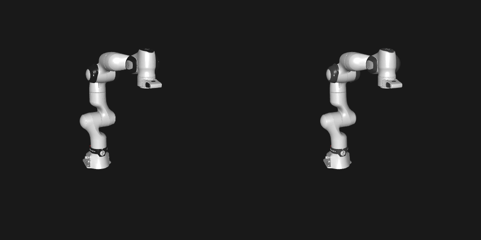

# Validation

## Round trip against MuJoCo Menagerie

The converter's ground truth: take a hand-tuned Menagerie model, convert it to USD with NVIDIA's
`mujoco-usd-converter` (which authors `mjcPhysics` schemas the way SimReady MuJoCo layers do),
convert it back with `srmj` (native backend), and compare with the original.

```bash
make roundtrip                                              # Franka FR3
scripts/roundtrip_menagerie.sh universal_robots_ur5e/ur5e.xml   # any Menagerie model
```

Results (2026-11-12, MuJoCo 4.0.1, mujoco-usd-converter 0.9.0):

| Model | Total mass | Per-joint mass / range / armature / damping / frictionloss | Actuators kp / kv / force range | Behaviour |
|---|---|---|---|---|
| Franka FR3 | 18.3156 vs 18.3155 kg | identical | identical | hold-pose error 0.00582439952 vs 0.00582439918 rad |
| UR5e | 20.99 vs 20.99 kg | identical | identical | hold-pose error 0.0081 vs 0.0081 rad |
| Kinova Gen3 | 8.188 vs 8.188 kg | identical | identical | hold-pose error 0.0044 vs 0.0044 rad |
| Robotiq 2F-85 (tendon + loop closures) | 1.0526 vs 1.0526 kg | identical | identical (tendon actuator) | closed: 0.7808 / 0.7799 / −0.7555 vs 0.7808 / 0.7799 / −0.7556 rad |

Visual check (FR3, home pose; left = converted, right = Menagerie original):



What the round trip does **not** cover: assets authored only with UsdPhysics/PhysX (no MuJoCo
layer), e.g. the SimReady Robotiq 2F-85 and NVIDIA props. Those are covered by the synthetic
fixtures in `tests/` and by `srmj compare` against Menagerie where a model exists.

## Unit tests

`tests/test_native.py` builds small USD assets in code and checks the compiled MuJoCo model:
authored vs computed mass, hinge anchors, limits in SI units, drive → PD actuator gains, drive
reaching its target in simulation, physics-material friction, contact filtering, `MjcActuator`
pass-through, free joints for loose bodies, PhysX and Newton mimic joints tracking in
simulation, joint reference angles, fixed tendons.
